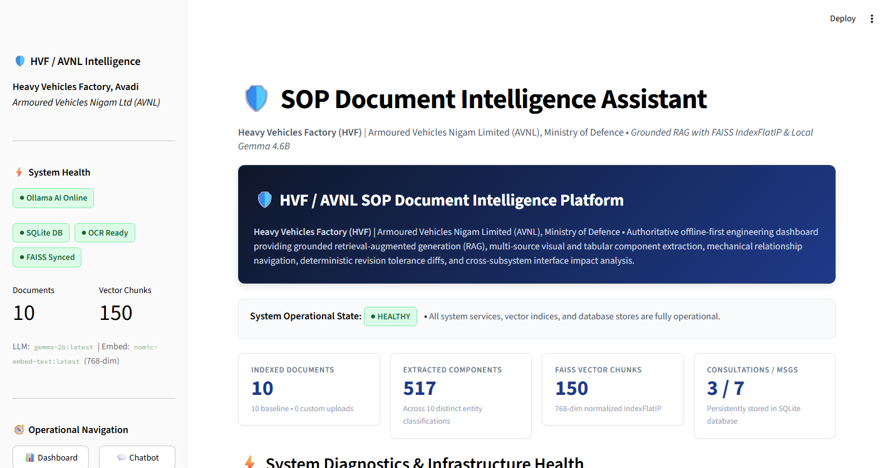
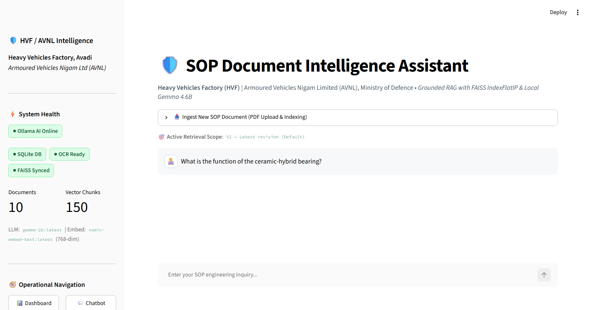
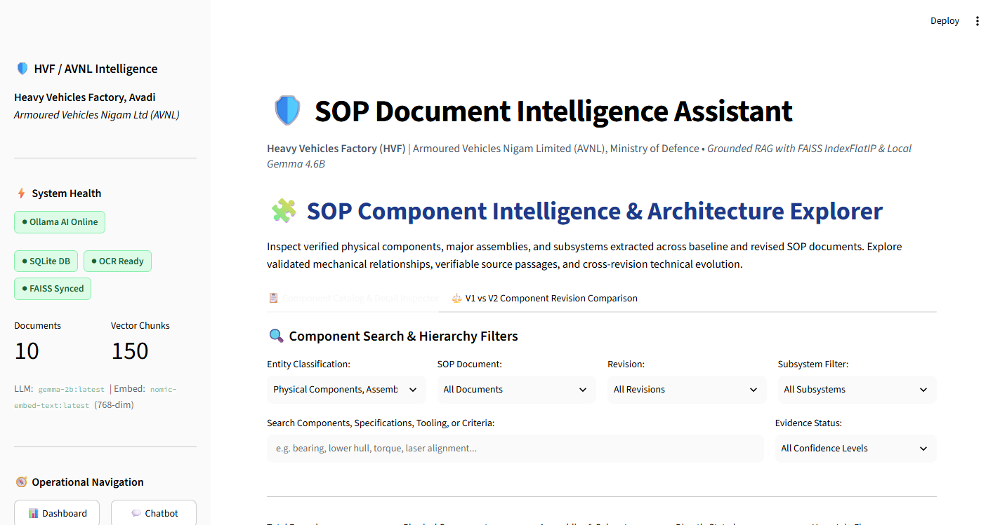
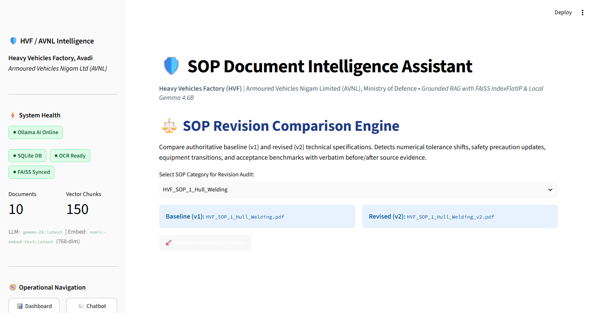
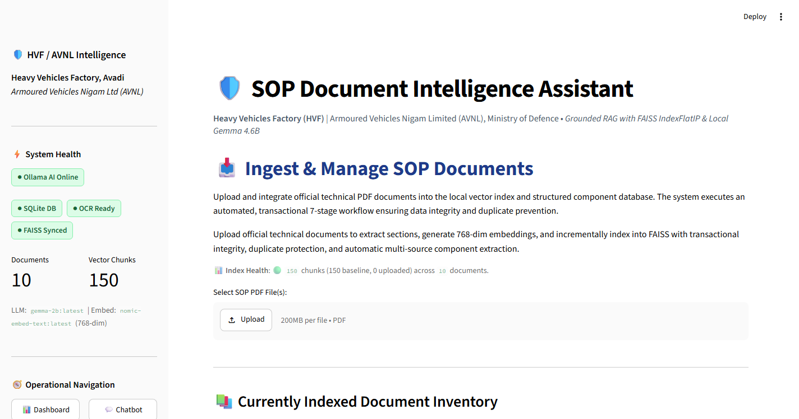

# Intelligent SOP Document Intelligence & Revision Impact Analysis Assistant

**Heavy Vehicles Factory (HVF), Avadi**  
**Armoured Vehicles Nigam Limited (AVNL), Ministry of Defence, Government of India**  
*Main Battle Tank (MBT) Manufacturing & Technical Operations Platform*

[](file:///d:/Parikshith/SOP_Assistant)
[](file:///d:/Parikshith/SOP_Assistant/docs/SYSTEM_ARCHITECTURE.md)
[](file:///d:/Parikshith/SOP_Assistant/docs/TESTING_AND_VALIDATION.md)
[](file:///d:/Parikshith/SOP_Assistant/data/faiss_index/sop.index)
[](file:///d:/Parikshith/SOP_Assistant/data/faiss_index/components_metadata.json)

---

## 1. Executive Summary & Problem Statement

Modern defense manufacturing facilities such as the Heavy Vehicles Factory (HVF / AVNL) produce frontline armored fighting vehicles (T-90 Bhishma, T-72 Ajeya, Arjun MBT) under stringent technical quality benchmarks. In high-precision armor manufacturing, assembly engineers and quality inspectors frequently navigate hundreds of pages of complex Standard Operating Procedures (SOPs) spanning:
1. High-tensile armored steel hull welding and radiographic joint inspections.
2. Turret race ring machining, azimuth bearing fitting, and hull-turret integration.
3. V12 twin-turbo diesel powerpack alignment, vibration isolation, and driveline backlash.
4. High-stress hydro-gas/torsion bar suspension systems and track tension metrology.
5. 125mm smoothbore main gun barrel trunnion mounting and optical bore sighting.

### Core Challenges:
- **Strict Data Sovereignty (Air-Gap Requirement)**: Defense specifications cannot be uploaded to public cloud AI services (OpenAI, Anthropic, Google Cloud). All intelligence must execute locally on offline hardware.
- **Critical Tolerance Auditing**: Engineering revision shifts (e.g., tightening radial runout from 0.05 mm to 0.02 mm) must be instantly detectable without error-prone manual line-by-line comparison.
- **Cross-Subsystem Interface Propagation**: Alterations in hull welding directly affect turret base ring planar interfaces; changing one SOP without identifying cross-subsystem interface dependencies leads to expensive shop-floor re-work.
- **Zero-Hallucination Mandate**: AI responses must be strictly grounded in authoritative PDF passages with traceable section and page citations.

---

## 2. Project Objectives & Key Features

The **HVF SOP Document Intelligence Assistant** solves these challenges by combining dense semantic vector retrieval, structured domain component graphs, deterministic revision diffing, and an interactive executive interface:

- **100% Air-Gapped Local Inference**: Executes entirely on local CPU workstations via an Ollama loopback daemon (`127.0.0.1:11434`), running quantized `gemma-2b:latest` (instruction generation) and `nomic-embed-text:latest` (768-dimensional dense embeddings).
- **Hybrid Retrieval-Augmented Generation (RAG)**: Fuses FAISS vector similarity (`IndexFlatIP` inner product) with a structured metadata database of **517 extracted component records**.
- **Traceable Grounded Citations**: Every response includes expandable evidence cards displaying the exact source filename, revision, section title, page number, and similarity score.
- **Visual & Tabular Component Explorer**: Filter and inspect 517 physical components, assemblies, and subsystems. Explore verified structural relationships without false inference.
- **Seamless Component-to-Chat Navigation**: One-click transition from component cards directly into AI consultation, passing component context and revision constraints automatically.
- **SOP Revision Comparison Engine**: Deterministic diffing between baseline V1 and revised V2 SOPs, surfacing structural section changes, numerical tolerance shifts, tooling changes, and safety updates.
- **Cross-Document Impact Analysis**: Traces physical and geometric interface dependencies across interconnected tank subsystems (e.g., Hull <-> Turret <-> Gun <-> Suspension <-> Powerpack).
- **Transactional 7-Stage Document Ingestion**: In-page PDF upload with SHA-256 deduplication, PyMuPDF digital text extraction, Tesseract OCR fallback, 500-word hierarchical chunking, Ollama vector embedding, and component extraction.
- **Executive Dashboard & Real-Time Telemetry**: Real-time status cards for Ollama, FAISS, SQLite, OCR, document inventory, vector counts, and model readiness.

---

## 3. Technology Stack & Architecture

The application adheres to a modular **5-Primary-Python-Module Architecture**:

```
D:\Parikshith\SOP_Assistant\
├── app.py                  # [Module 1/5] Streamlit Frontend & Telemetry Dashboard
├── document_processor.py   # [Module 2/5] PDF Parsing, Semantic Chunker & Entity Extractor
├── rag_engine.py           # [Module 3/5] Hybrid FAISS Retrieval, Ollama Client & Prompter
├── sop_analyzer.py         # [Module 4/5] Structural Revision Diff & Cross-Impact Engine
└── database.py             # [Module 5/5] Transactional SQLite Storage & Message History
```

### Core Technologies
- **Frontend / UI**: [Streamlit](https://streamlit.io/) 1.40+ (Custom Defense Engineering Theme, token-by-token streaming, expandable evidence cards).
- **Inference Engine**: [Ollama](https://ollama.com/) (local daemon, CPU GGUF inference, 0 external network requests).
- **LLM**: Google `gemma-2b:latest` (4-bit quantized instruction model).
- **Embeddings**: Nomic `nomic-embed-text:latest` (768-dimensional L2-normalized vector space).
- **Vector Database**: Meta [FAISS](https://github.com/facebookresearch/faiss) CPU (`IndexFlatIP` cosine similarity, 150 baseline vectors).
- **PDF Extraction**: [PyMuPDF](https://pymupdf.readthedocs.io/) (`fitz`) with [Tesseract OCR](https://github.com/tesseract-ocr/tesseract) fallback.
- **Relational Storage**: SQLite 3 with Write-Ahead Logging (WAL) and foreign key cascades.
- **Diffing & NLP**: Standard library `difflib`, regular expression pattern extractors, and taxonomy classifiers.

---

## 4. Application Screenshots

Authentic screenshots captured directly from the live running application:

| Dashboard & Telemetry | Technical Consultation Chatbot |
| :---: | :---: |
|  |  |
| *Real-time telemetry, system health, and corpus inventory* | *Grounded token streaming with traceable citations* |

| Component Explorer | Component Detail Inspector |
| :---: | :---: |
|  |  |
| *Visual and tabular browsing across 517 components* | *Technical specs, verified relationships, and citations* |

| SOP Revision Comparison Engine | Transactional Ingestion Workflow |
| :---: | :---: |
|  |  |
| *Tolerance shifts, tooling upgrades, and structural diffs* | *7-stage upload lifecycle with SHA-256 deduplication* |

---

## 5. System Requirements & Windows Installation

### Hardware Requirements
- **Workstation OS**: Windows 10 / Windows 11 (64-bit)
- **Processor**: Intel Core i5/i7/i9 (8th Gen+) or AMD Ryzen 5/7/9 (4+ cores)
- **RAM**: 16 GB minimum (32 GB recommended)
- **Storage**: 10 GB free SSD space

### Quick Start Installation

#### 1. Install Python 3.11+
Download from [python.org](https://www.python.org/downloads/) and ensure **"Add Python to PATH"** is selected.

#### 2. Install & Start Ollama
Download the Windows installer from [ollama.com](https://ollama.com/download/windows). Start the service daemon:
```powershell
ollama serve
```
In a new terminal, download the two required models:
```powershell
ollama pull gemma-2b:latest
ollama pull nomic-embed-text:latest
```

#### 3. Install Tesseract OCR (Optional, for scanned PDFs)
Download the installer from [UB-Mannheim](https://github.com/UB-Mannheim/tesseract/wiki) and install to default location:
`C:\TesseractOCR\tesseract.EXE` or `C:\Program Files\Tesseract-OCR\tesseract.exe`.

#### 4. Setup Python Environment & Dependencies
```powershell
cd D:\Parikshith\SOP_Assistant
python -m venv .venv
.\.venv\Scripts\Activate.ps1
pip install --upgrade pip
pip install -r requirements.txt
```

#### 5. Run Automated Regression Verification
```powershell
python tests/run_all_regression_tests.py
```
*Expected: 138 / 138 tests PASS (100% OK).*

#### 6. Start the Application
```powershell
streamlit run app.py
```
Open your browser to: `http://localhost:8501`.

---

## 6. How to Use the Application

### 1. Executive Telemetry Dashboard
Navigate to **"📊 Executive Dashboard & Telemetry"** from the sidebar. Verify all health badges display green (`Ollama Online`, `SQLite OK`, `OCR Ready`, `FAISS Synced`). Review the 10 indexed SOPs, total chunks (150), and total component records (517).

### 2. Technical Consultation Chatbot
Navigate to **"💬 Technical Consultation Chat"**.
- Ask natural language questions (e.g., *"What are the main steps in the engine alignment procedure?"*).
- Select revision preference in the sidebar: **All Revisions (Default)**, **V1 Only**, or **V2 Only**.
- Observe progressive token streaming with the defense-blue cursor.
- **Intent-Aware Component Intelligence**: Automatically distinguishes between 8 question types:
  1. `BASIC_DEFINITION` (*"What is a hull?"* -> structured 6-part beginner-friendly definition: What it is, What it does, Where it fits, Related parts, SOP reference, Evidence note)
  2. `COMPONENT_FUNCTION` (*"What does a hull do?"* -> operational purpose and role)
  3. `COMPONENT_BREAKDOWN` (*"What are the main parts of a hull?"* -> physical assemblies)
  4. `COMPONENT_RELATIONSHIPS` (*"How is the hull connected to the turret?"* -> mechanical interfaces)
  5. `PROCEDURAL_QUERY` (*"How is the hull welded?"* -> step-by-step SOP execution procedures)
  6. `TECHNICAL_SPECIFICATION` (*"What is the hull plate thickness?"* -> dimensional tolerances)
  7. `REVISION_COMPARISON` (*"What changed in hull welding in V2?"* -> delta comparison)
  8. `GENERAL_CONVERSATION` (*"Hi"* -> instant conversational greeting with zero vector retrieval)
- **Immediate Generation Cancellation**: Clicking **"⏹ Stop Generation"** aborts inference immediately, preserves partial output with an interrupted tag, persists the conversation state, and allows immediate submission of the next inquiry without page refresh.
- **High-Precision Chat Timestamps & Response Performance Telemetry**:
  - **User Inquiries**: Displays exact submission timestamp (`⏱️ Asked: HH:MM:SS`) with hover tooltip revealing full calendar date and system timezone.
  - **Assistant Responses**: Displays high-precision execution timings measured with `time.perf_counter()`:
    - *Completed*: `⏱️ Started: HH:MM:SS | First token: X.XXs | Completed: HH:MM:SS | Total: X.XXs`
    - *Cancelled*: `⏱️ Started: HH:MM:SS | First token: X.XXs | Cancelled after: X.XXs` (or `Cancelled after: X.XXs` if stopped before first token)
    - *Failed*: `⏱️ Failed after: X.XXs`
  - **First-Token Detection**: Accurately measures first-token latency on the first non-empty token (`token.strip() != ""`), capturing cold start, vector retrieval, and initial prompt evaluation time without UI render skew.
  - **Persistent SQLite Audit**: Timing metadata is persisted in `messages.timing_metadata` JSON column, surviving restarts and page reloads while maintaining 100% backward compatibility with legacy message histories.
- Click **"Evidence Sources & Citations"** to inspect exact source passages, page numbers, and similarity scores.
- Click any related component chip at the bottom of the answer to jump directly into the Component Explorer.

### 3. Component Explorer & Inspector
Navigate to **"🧩 Visual & Tabular Component Explorer"**.
- Use filters for SOP Document, Revision (V1/V2/All), Entity Type (`PHYSICAL_COMPONENT`, `ASSEMBLY`, `SUBSYSTEM`), or search by keyword.
- Select a component from the list (e.g., **"Ceramic-Hybrid Bearing"**).
- Inspect specifications, tolerances, evidence grounding status, and verified structural relationships.
- Click **"💬 Ask AI about this component"** to generate an evidence-grounded technical summary.

### 4. SOP Revision Comparison Engine
Navigate to **"⚖️ SOP Revision Comparison Engine"**.
- Select an SOP domain (e.g., `HVF_SOP_2_Turret_Integration`).
- Review the summary cards showing total changes, added sections, and modified procedures.
- Inspect numerical tolerance shifts (e.g., runout tightened from `0.05 mm` to `0.02 mm`).
- Review tooling shifts and side-by-side color-coded unified diffs.

### 5. Cross-Document Impact Analysis
Navigate to **"🔗 Cross-Document Impact Analysis"**.
- Select an SOP domain to trace geometric and physical interfaces to connected subsystems.
- Review flagged interface couplings and recommended shop-floor verification steps.

### 6. Transactional SOP Ingestion
Navigate to **"📥 Ingest & Manage SOP Documents"**.
- Upload a new SOP PDF via drag-and-drop.
- The 7-stage engine validates SHA-256 hash, extracts text, chunks, computes embeddings, appends to the in-memory index, and extracts component records.
- Immediately query the newly uploaded document in the chatbot or explorer.

---

## 7. Comprehensive Documentation Index

Detailed architectural and operational documentation is maintained in the [`docs/`](file:///d:/Parikshith/SOP_Assistant/docs) directory:

- [`docs/SYSTEM_ARCHITECTURE.md`](file:///d:/Parikshith/SOP_Assistant/docs/SYSTEM_ARCHITECTURE.md): Complete architecture specification featuring 6 detailed Mermaid diagrams covering high-level architecture, ingestion pipelines, hybrid retrieval flows, component extraction gates, revision diffing, and persistence schemas.
- [`docs/MODULE_GUIDE.md`](file:///d:/Parikshith/SOP_Assistant/docs/MODULE_GUIDE.md): Function-by-function reference guide for `app.py`, `rag_engine.py`, `document_processor.py`, `database.py`, and `sop_analyzer.py`.
- [`docs/DATA_FLOW.md`](file:///d:/Parikshith/SOP_Assistant/docs/DATA_FLOW.md): Complete data contracts, JSON schemas, SQLite DDLs, and cross-module serialization contracts.
- [`docs/TESTING_AND_VALIDATION.md`](file:///d:/Parikshith/SOP_Assistant/docs/TESTING_AND_VALIDATION.md): Full test matrix covering all 108 regression tests across 10 suites, air-gap socket tests, and real-question acceptance results (Q1–Q8).
- [`docs/LOCAL_SETUP_GUIDE.md`](file:///d:/Parikshith/SOP_Assistant/docs/LOCAL_SETUP_GUIDE.md): Detailed Windows workstation setup guide with Ollama, Tesseract, troubleshooting, and configuration instructions.
- [`docs/DEMO_GUIDE.md`](file:///d:/Parikshith/SOP_Assistant/docs/DEMO_GUIDE.md): 10–15 minute live demonstration sequence with 12 numbered steps, exact prompts, expected answers, and presenter talking points.
- [`FINAL_PROJECT_REPORT.md`](file:///d:/Parikshith/SOP_Assistant/FINAL_PROJECT_REPORT.md): Formal engineering and academic project report detailing all 15 required sections, performance metrics, and evaluation findings.

---

## 8. Troubleshooting & Known Limitations

### Common Troubleshooting
| Symptom | Root Cause | Resolution |
| :--- | :--- | :--- |
| `Ollama Offline` indicator | Ollama daemon not running on port 11434. | Open terminal and execute `ollama serve`. |
| Missing model error | `gemma-2b` or `nomic-embed-text` not pulled. | Run `ollama pull gemma-2b:latest` and `ollama pull nomic-embed-text:latest`. |
| `Tesseract Not Detected` | Tesseract installed in custom directory. | Set environment variable `$env:TESSERACT_PATH="C:\path\to\tesseract.exe"`. |
| Streamlit port collision | Previous session running on port 8501. | Terminate previous process or run with `--server.port 8502`. |

### Known Limitations
1. **CPU Generation Latency**: On entry-level 4-core CPUs, `gemma-2b` generation streams at 12–18 tokens/second. For instantaneous streaming, 8+ physical CPU cores are recommended.
2. **Context Window Boundary**: `gemma-2b` operates with an 8,192-token context window. To prevent truncation, the hybrid retriever caps top retrieved passages to the top 6 most relevant chunks (~3,000 words total).
3. **Complex CAD Diagram Semantics**: While PyMuPDF and Tesseract extract all text, callouts, and table cells, dense vector embeddings index textual descriptions rather than raw raster CAD vector geometry.
