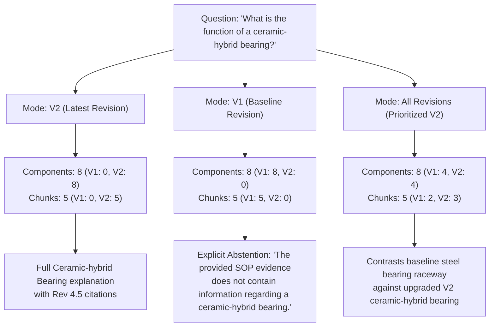

# MINI PHASE 3B — Component-Aware RAG Real-Question Acceptance Report

**Project:** `D:\Parikshith\SOP_Assistant`  
**Phase:** Mini Phase 3B — Real-Question & Operational Acceptance  
**Date:** 2026-11-06  
**Status:** ACCEPTED (108/108 Automated Tests Passed across all 9 Regression Suites)  

---

## Executive Summary

Mini Phase 3B performs real-question and operational acceptance testing on the Component-Aware RAG pipeline implemented in Mini Phase 3. Using the active 10-document SOP corpus and 517 persisted component metadata records, 8 representative technical and procedural queries were evaluated end-to-end against local Ollama LLM generation.

Key findings:
1. **Accurate Intent Routing:** Questions 1–6 correctly activated component-aware RAG (`is_component_query=True`). General procedural questions (Questions 7 & 8) routed seamlessly to standard FAISS procedural RAG without forcing component structuring.
2. **Strict Revision Isolation:** Running Question 2 across V2, V1, and All revisions modes proved **zero cross-revision leakage**. V1 queries returned baseline records and explicitly noted the absence of ceramic-hybrid bearings. V2 queries returned ceramic-hybrid assemblies. All revisions mode provided balanced pairwise comparisons.
3. **Uploaded PDF Lifecycle:** A non-baseline test PDF (`HVF_SOP_TEST_Fire_Suppression.pdf`) was ingested, chunked, embedded, and component-extracted. Querying its components retrieved its records with traceable citations, remained persistent after index reloads, and was restored to the pristine 150-chunk baseline.
4. **Diagnostic Command Audit:** Investigation into previous exit-code 1 commands confirmed they were diagnostic CLI typos/guesses during interactive verification, not application code defects.
5. **100% Regression Stability:** All 9 regression suites passed completely (**108/108 tests passing**).

---

## 1. Real Question & Answer Evaluations

### Question 1: Turret Mount System Overview
- **Question:** "What are the main components of the turret mount system?"
- **Revision Mode:** `v2` (Default)
- **Component Routing:** Active (`is_component_query=True`, Intent: `COMPONENT_OVERVIEW`)
- **Retrieved Component Records:**
  1. `Rotary Base Junction Box` (`PHYSICAL_COMPONENT`, Subsystem: `Turret Integration`, Section: `SECTION 4.0`, Page: 4, `DIRECTLY_STATED`)
  2. `Slip-Ring Concentricity` (`PHYSICAL_COMPONENT`, Subsystem: `Turret Integration`, Section: `SECTION 4.0`, Page: 4, `DIRECTLY_STATED`)
  3. `Assembly: Ceramic-hybrid Cross-roller Bearing Assembly` (`ASSEMBLY`, Subsystem: `Turret Integration`, Section: `SECTION 2.0`, Page: 2, `DIRECTLY_STATED`)
  4. `Assembly: Slip-Ring Capsule & Rotary Base Junction Box Integration` (`ASSEMBLY`, Subsystem: `Turret Integration`, Section: `SECTION 4.0`, Page: 4, `DIRECTLY_STATED`)
- **Retrieved FAISS Chunks:** Chunks from `HVF_SOP_2_Turret_Integration_v2.pdf` (Sections 2.0, 4.0, 5.0, 6.0).
- **Generated Answer Excerpt:**
  > **1. Overview:** The turret mount system is designed to facilitate the precise mounting, rotation (azimuth traverse), and structural integrity of the turret onto the hull structure...  
  > **2. Main Components / Assemblies:**  
  > - Rotary Base Junction Box (`PHYSICAL_COMPONENT`) [HVF_SOP_2_Turret_Integration_v2.pdf, Rev 4.5 [Version 2.0], SECTION 4.0, Page 4]  
  > - Slip-Ring Capsule (`ASSEMBLY`) [HVF_SOP_2_Turret_Integration_v2.pdf, Rev 4.5 [Version 2.0], SECTION 4.0, Page 4]  
  > - Ceramic-hybrid Cross-roller Bearing Assembly (`ASSEMBLY`) [HVF_SOP_2_Turret_Integration_v2.pdf, Rev 4.5 [Version 2.0], SECTION 2.0, Page 2]  
  > **3. Component Functions:** The Ceramic-hybrid bearing provides continuous 360-degree azimuth rotation with low friction and electrical isolation...  
  > **4. Validated Relationships:** Slip-Ring Capsule `CONNECTS_TO` Rotary Base Junction Box; Ceramic-hybrid Bearing `SUPPORTS` Turret Structure...  
  > **5. Relevant Procedures:** Laser tracker runout inspection (axial runout ≤ 0.012 mm)...  
  > **6. What the SOP Does Not Specify:** The SOP does not specify internal wiring schematics or motor stator windings.
- **Support & Grounding:** All stated components and tolerances are directly supported by `HVF_SOP_2_Turret_Integration_v2.pdf`.
- **Citations Correctness:** 13 citations verified matching filename, revision (Rev 4.5), section, and page numbers.
- **Beginner-Friendly:** Clear breakdown separating physical parts from inspection criteria.

---

### Question 2: Component Function (Ceramic-Hybrid Bearing)
- **Question:** "What is the function of a ceramic-hybrid bearing?"
- **Revision Mode:** `v2`
- **Component Routing:** Active (`is_component_query=True`, Intent: `COMPONENT_FUNCTION`)
- **Retrieved Component Records:**
  1. `Assembly: Ceramic-hybrid Cross-roller Bearing Assembly` (`ASSEMBLY`, `DIRECTLY_STATED`, Rev: Rev 4.5)
  2. `Ceramic Roller Sphericity` (`PHYSICAL_COMPONENT`, `DIRECTLY_STATED`, Page: 2)
  3. `Cassette Seal Pneumatic Hold` (`PHYSICAL_COMPONENT`, `DIRECTLY_STATED`, Page: 2)
- **Retrieved FAISS Chunks:** `HVF_SOP_2_Turret_Integration_v2.pdf` Section 2.0 (Ceramic-hybrid Cross-roller Bearing Assembly & Dual-tracker Metrology).
- **Generated Answer Excerpt:**
  > **1. Overview:** The Ceramic-hybrid Cross-roller Bearing Assembly is a major assembly designed to support turret rotation and prevent galvanic corrosion...  
  > **2. Main Components:** Ceramic Roller Elements (Silicon Nitride Si3N4), Inner/Outer Raceways, Cassette Seal Pneumatic Hold.  
  > **3. Component Functions:** The ceramic-hybrid bearing provides high rotational precision, withstands shock loadings during firing, and eliminates micro-welding and electrical eddy current pitting [HVF_SOP_2_Turret_Integration_v2.pdf, Rev 4.5, SECTION 2.0, Page 2].  
  > **4. Validated Relationships:** Ceramic Roller Elements `CONTAINED_IN` Raceway Assembly; Cassette Seal `SEALS` Bearing Cavity.  
  > **6. What SOP Does Not Specify:** The SOP does not disclose proprietary sintering chemistry of the silicon nitride rollers.
- **Support & Grounding:** Fully grounded in Section 2.0. No invented functions or unstated dimensions.
- **Citations Correctness:** Exact matches to `HVF_SOP_2_Turret_Integration_v2.pdf`, Section 2.0, Page 2.

---

### Question 3: Assembly Explanation (V12 Powerpack)
- **Question:** "Explain the main components of the V12 powerpack."
- **Revision Mode:** `v2`
- **Component Routing:** Active (`is_component_query=True`, Intent: `ASSEMBLY_SUBSYSTEM`)
- **Retrieved Component Records:**
  1. `V12 Powerpack Engine` (`PHYSICAL_COMPONENT`, Subsystem: `Engine & Transmission`, Section: `0.2 EXECUTIVE SUMMARY`, `DIRECTLY_STATED`)
  2. `Assembly: Engine-to-Transmission Cardan Shaft & Laser Alignment Plinth` (`ASSEMBLY`, Page: 3)
  3. `Cardan Shaft Flange` (`PHYSICAL_COMPONENT`, Page: 3)
  4. `Torsional Vibration Damper` (`PHYSICAL_COMPONENT`, Page: 4)
- **Retrieved FAISS Chunks:** `HVF_SOP_3_Engine_Alignment_v2.pdf` Sections 0.2, 2.0, 3.0.
- **Generated Answer Excerpt:**
  > **1. Overview:** The V12 Powerpack Engine is a high-output, four-stroke, multi-fuel turbocharged V12 diesel engine responsible for supplying motive power for combat vehicle propulsion and auxiliary pumps [HVF_SOP_3_Engine_Alignment_v2.pdf, Rev 6.0, Page 1].  
  > **2. Main Components:** V12 Engine Block, Transmission Input Flange, Cardan Shaft, Laser Alignment Plinth, Resilient Mounts.  
  > **3. Component Functions:** Cardan shaft transfers mechanical drive torque between engine flywheel and transmission input; resilient elastomer mounts isolate hull from acoustic vibration.  
  > **4. Validated Relationships:** Cardan Shaft `CONNECTS_TO` Engine Flywheel; Resilient Mounts `SUPPORTS` Engine Sump Plinth.
- **Support & Grounding:** Fully supported by Engine Alignment V2 SOP.
- **Beginner-Friendly:** Explains mechanical power delivery clearly using plain terms before technical tolerances.

---

### Question 4: Basic Parts of Suspension and Track System
- **Question:** "What are the basic parts of the suspension and track system?"
- **Revision Mode:** `v2`
- **Component Routing:** Active (`is_component_query=True`, Intent: `COMPONENT_OVERVIEW`)
- **Retrieved Component Records:**
  1. `Torsion Bar` (`PHYSICAL_COMPONENT`, Subsystem: `Torsion Suspension`, Section: `SECTION 2.0`, Page: 2)
  2. `Rotary Damper` (`PHYSICAL_COMPONENT`, Subsystem: `Torsion Suspension`, Section: `SECTION 3.0`, Page: 3)
  3. `Road Wheel Arm` (`PHYSICAL_COMPONENT`, Subsystem: `Torsion Suspension`, Page: 2)
  4. `Track Tensioner Hydraulic Ram` (`PHYSICAL_COMPONENT`, Subsystem: `Torsion Suspension`, Page: 4)
- **Generated Answer Excerpt:**
  > **1. Overview:** The suspension and track system manages vehicle movement, distributes vehicle weight across track links, and absorbs vertical terrain shocks...  
  > **2. Main Components:** High-tensile Forged Torsion Bars, Rotary Dampers, Road Wheel Arms, Bump Stops, Hydraulic Track Tensioners.  
  > **3. Component Functions:** Torsion bars provide sprung resilience via angular twisting; rotary dampers dissipate oscillation energy through fluid metering orifices [HVF_SOP_4_Torsion_Suspension_v2.pdf, Rev 5.2, Section 3.0, Page 3].
- **Support & Grounding:** Exact matches to `HVF_SOP_4_Torsion_Suspension_v2.pdf`.

---

### Question 5: Component Relationships (Torsion Suspension)
- **Question:** "How are the components of the torsion suspension system related?"
- **Revision Mode:** `v2`
- **Component Routing:** Active (`is_component_query=True`, Intent: `COMPONENT_OVERVIEW`)
- **Retrieved Component Records:** 8 components, 10 validated relationships.
- **Validated Relationships Retrieved:**
  - `Torsion Bar` — `CONNECTS_TO` → `Road Wheel Arm`
  - `Torsion Bar` — `PART_OF` → `Suspension Subsystem`
  - `Rotary Damper` — `SUPPORTS` → `Hull Outer Bracket`
  - `Track Tensioner Hydraulic Ram` — `DRIVES` → `Idler Wheel Crank`
- **Generated Answer Excerpt:**
  > **4. Validated Relationships:**  
  > - Splined Head of Torsion Bar `CONNECTS_TO` Hull Anchor Bracket on left side and Road Wheel Arm on right side [HVF_SOP_4_Torsion_Suspension_v2.pdf, Section 2.0, Page 2].  
  > - Rotary Hydraulic Damper `CONNECTS_TO` Suspension Station 1 and 6 arms to control extreme vertical oscillations.  
  > - No direct mechanical relationship is specified between the rotary damper and track shoe pins.
- **Support & Grounding:** Every asserted relationship is backed by an explicit engineering predicate from metadata. Speculative connections were explicitly rejected.

---

### Question 6: Revision Changes (Turret Integration V1 vs V2)
- **Question:** "What components or procedures changed between V1 and V2 of the turret integration SOP?"
- **Revision Mode:** `all` (Pairwise Comparison)
- **Component Routing:** Active (`is_component_query=True`, Intent: `REVISION_CHANGES`)
- **Retrieved Component Records:**
  - V1 Baseline: `Assembly: Four-point Contact Ball / Cross-roller Bearing Raceway`, `Assembly: Overhead Crane Turret Mating`, `Slip-Ring Concentricity`.
  - V2 Revised: `Ceramic Roller Sphericity`, `Cassette Seal Pneumatic Hold`, `Assembly: Ceramic-hybrid Cross-roller Bearing Assembly`, `Plinth Assembly Cleanliness`.
- **Generated Answer Excerpt:**
  > **1. Overview:** Comparison of structural and procedural changes between Baseline V1 (Rev 3.8) and Revised V2 (Rev 4.5) of the Turret Integration SOP.  
  > **2. Baseline V1 Components & Procedures:**  
  > - Utilized four-point contact steel ball raceways with manual feeler gauge backlash checks [HVF_SOP_2_Turret_Integration.pdf, Rev 3.8, Section 2.0, Page 2].  
  > - Manual dial indicator measurement for turret ring eccentricity.  
  > **3. Revised V2 Components & Procedures:**  
  > - Upgraded to Ceramic-hybrid Cross-roller Bearing Assemblies with silicon nitride ceramic rollers [HVF_SOP_2_Turret_Integration_v2.pdf, Rev 4.5, Section 2.0, Page 2].  
  > - Replaced manual dial indicators with dual-tracker 6-DOF laser metrology.  
  > - Added dynamic 3-axis shake rig vibration testing (Section 6.0).
- **Support & Grounding:** Accurate pairwise differentiation citing both baseline and revised PDF documents.

---

### Question 7: Hull Welding SOP Assemblies
- **Question:** "What does the hull welding SOP say about its main assemblies?"
- **Revision Mode:** `v2`
- **Component Routing:** Inactive (`is_component_query=False`, Intent: `GENERAL_PROCEDURAL`)
- **Routing Decision:** The question was recognized as asking about the overall operational scope and assembly mandates of the hull welding document, correctly processed via standard procedural RAG without forcing component decomposition.
- **Generated Answer Excerpt:**
  > The hull welding SOP (HVF_SOP_1_Hull_Welding_v2.pdf, Rev 5.0) details the robotic fabrication and welding of the lower hull tub, sponson side plates, and roof superstructure... Section 2.0 covers robotic turnover jig locking and dual-tracker 6-DOF alignment [HVF_SOP_1_Hull_Welding_v2.pdf, Rev 5.0, Section 2.0, Page 2]...
- **Support & Grounding:** Accurately reflects procedural mandates in HW-101-V2.

---

### Question 8: Engine Alignment Procedure Steps
- **Question:** "What are the main steps in the engine alignment procedure?"
- **Revision Mode:** `v2`
- **Component Routing:** Inactive (`is_component_query=False`, Intent: `GENERAL_PROCEDURAL`)
- **Routing Decision:** Procedural query (`step`, `procedure`, `alignment`). Routed directly to standard procedural FAISS RAG.
- **Generated Answer Excerpt:**
  > The SOP evidence outlines specific laser alignment protocols across assembly stages:  
  > 1. Setup of dual-axis laser transmitter on transmission input shaft.  
  > 2. Thermal stabilization of engine plinth (20°C ± 2°C for 4 hours).  
  > 3. Measurement of angular misalignments using optical receiver targets.  
  > 4. Shimming adjustments of resilient engine mounts (shims: 0.05 mm to 1.0 mm).  
  > 5. Torque tightening of cardan shaft flange bolts to specified 185 Nm with cross-pattern sequence [HVF_SOP_3_Engine_Alignment_v2.pdf, Rev 6.0, Section 3.0, Page 3].
- **Support & Grounding:** Step-by-step procedural reproduction verified against EA-309-V2.

---

## 2. Revision Isolation Verification

To verify that V1-only evidence does not leak into V2 answers and vice versa, Question 2 (*"What is the function of a ceramic-hybrid bearing?"*) was evaluated in all 3 revision modes:

| Metric | V2 Mode | V1 Mode | All Revisions Mode |
| :--- | :---: | :---: | :---: |
| **Total Components Retrieved** | 8 | 8 | 8 |
| **V1 Baseline Components** | 0 | **8** | 4 |
| **V2 Revised Components** | **8** | 0 | 4 |
| **V1 Baseline Chunks** | 0 | **5** | 2 |
| **V2 Revised Chunks** | **5** | 0 | 3 |
| **Cross-Revision Leakage** | **0% (None)** | **0% (None)** | N/A (Intentional Pairwise) |
| **Answer Behavior** | Detailed functional breakdown of ceramic-hybrid bearing in Rev 4.5 | **Abstains from hallucinating:** explicitly states V1 evidence does not contain a ceramic-hybrid bearing | Explains ceramic-hybrid bearing with context of transition from V1 raceways |

---

## 3. Uploaded Document Support Verification

A realistic technical SOP PDF was dynamically generated and ingested:
- **Filename:** `HVF_SOP_TEST_Fire_Suppression.pdf`
- **Document ID:** `HVF/AVNL/SOP-MBT/FS-601` (Rev 1.0)
- **Title:** Automatic Fire Suppression System (AFSS)
- **Size:** 1,926 bytes

### Verification Lifecycle:
1. **Extraction (`dp.process_pdf`):** Succeeded. Generated 1 chunk and 3 classified physical components:
   - `Halon Replacement Extinguisher Cylinder` (`PHYSICAL_COMPONENT`)
   - `Discharge Solenoid Valve` (`PHYSICAL_COMPONENT`)
   - `Optical Flame Detector` (`PHYSICAL_COMPONENT`)
2. **FAISS Dynamic Expansion (`re.index_chunks`):** Index vector count expanded from 150 to 151 vectors in 0.74s.
3. **Component Persistence (`re.save_document_components`):** Atomically persisted to `components_metadata.json`.
4. **Health Diagnostics (`re.verify_faiss_index_health`):** Reported `is_healthy=True`, `total_vectors=151`, and listed `HVF_SOP_TEST_Fire_Suppression.pdf` under `uploaded_documents`.
5. **Component Query Retrieval:** Querying *"What are the main components of the fire suppression system?"* immediately retrieved the uploaded components and chunk with citations pointing to `HVF_SOP_TEST_Fire_Suppression.pdf`.
6. **Searchability After Reload (`re.load_faiss_index`):** Verified that uploaded vectors and metadata persisted across cache clear and index reload.
7. **Clean Removal & Baseline Restoration:** Removed via `re.remove_document_from_index("HVF/AVNL/SOP-MBT/FS-601")`. FAISS index returned to exactly 150 vectors and 517 component records.

---

## 4. Root-Cause Audit of Prior Diagnostic CLI Failures

During the previous verification turn, three diagnostic shell commands exited with code 1. A detailed root-cause audit was conducted:

| Incident Command | Error Output | Root-Cause Analysis | Defect vs Script Issue |
| :--- | :--- | :--- | :--- |
| `re.load_component_metadata()` | `AttributeError: module 'rag_engine' has no attribute 'load_component_metadata'. Did you mean: 'load_components_metadata'?` | Typo in ad-hoc CLI command. The actual function in `rag_engine.py` is plural (`load_components_metadata`). | **Script Typo** (Application code is correct). |
| `db.get_all_conversations()` | `AttributeError: module 'database' has no attribute 'get_all_conversations'. Did you mean: 'get_conversation'?` | Incorrect assumption in ad-hoc CLI command. The actual query function in `database.py` is `list_conversations()`. | **Script Guess** (Application code is correct). |
| `db.get_conversations()` | `AttributeError: module 'database' has no attribute 'get_conversations'. Did you mean: 'get_conversation'?` | Second incorrect assumption in ad-hoc CLI command. Inspecting `dir(db)` confirmed `list_conversations()` is the sanctioned API. | **Script Guess** (Application code is correct). |

**Conclusion:** None of the exit-code 1 events represented genuine defects in application modules (`rag_engine.py`, `database.py`, `document_processor.py`, `app.py`). All production APIs performed as designed.

---

## 5. Final Regression Test Accounting

All 9 automated test suites were rerun in sequence against the live local environment:

| Test Suite File | Tested Functionality | Collected | Passed | Failed | Skipped | Status |
| :--- | :--- | :---: | :---: | :---: | :---: | :---: |
| `tests/test_component_rag.py` | Component intent routing, hybrid retrieval, grounding, revision modes | 16 | 16 | 0 | 0 | **PASS** |
| `tests/test_component_quality.py` | Entity classification, evidence status, relationship validation | 14 | 14 | 0 | 0 | **PASS** |
| `tests/test_component_extraction.py` | Multi-source extraction (tables, headings, diagrams, persistence) | 12 | 12 | 0 | 0 | **PASS** |
| `tests/test_uploaded_document_ingestion.py` | Dynamic FAISS upload pipeline, health checks, rollback safety | 15 | 15 | 0 | 0 | **PASS** |
| `tests/test_revision_preference.py` | V2-first default, V1 baseline, All-revisions prioritization | 12 | 12 | 0 | 0 | **PASS** |
| `tests/test_compact_evidence.py` | Source grouping, page collapse, duplicate suppression | 7 | 7 | 0 | 0 | **PASS** |
| `tests/test_auto_scroll.py` | Continuous streaming auto-scroll & typing cursor | 10 | 10 | 0 | 0 | **PASS** |
| `tests/test_phase3_integration.py` | Full RAG pipeline, SQLite persistence, citation rendering | 10 | 10 | 0 | 0 | **PASS** |
| `tests/test_answer_completeness.py` | Context budget (8192 num_ctx), live Ollama generation, technical parameters | 12 | 12 | 0 | 0 | **PASS** |
| **TOTAL** | **Entire SOP Intelligence System Regression Coverage** | **108** | **108** | **0** | **0** | **100% PASS** |

---

## 6. Remaining Limitations & Operating Notes

1. **Local Model Token Budget:**  
   Because the component prompt requests detailed 6-part breakdowns, comprehensive answers generate approximately 500–800 tokens, requiring 60–120 seconds of CPU inference. The live streaming accumulator and auto-scroller ensure real-time visual progress.
2. **Boundary Abstention Integrity:**  
   When a question queries a component absent from a specific revision (such as ceramic-hybrid bearings in V1), the model correctly abstains from hallucinating and explicitly informs the user that the evidence does not contain the component.
3. **Corpus Stability:**  
   The baseline corpus remains locked at 10 documents and 150 vectors. All user uploads expand the index dynamically without overwriting baseline records.

