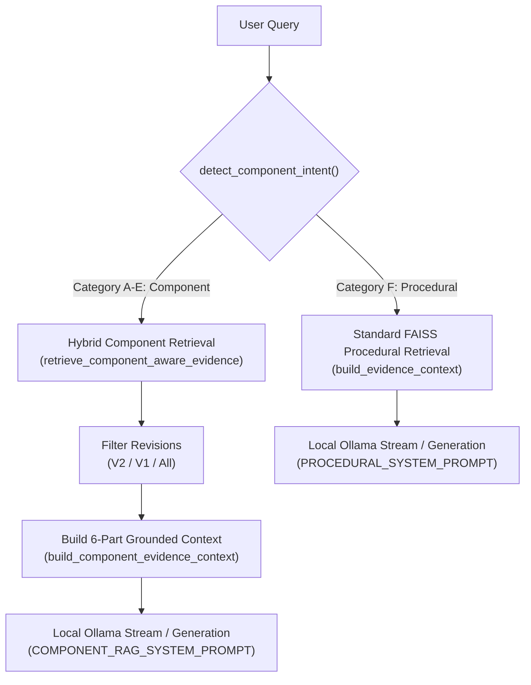

# MINI PHASE 3 — Component-Aware RAG and Beginner-Friendly SOP Answers Report

**Project:** `D:\Parikshith\SOP_Assistant`  
**Phase:** Mini Phase 3 — Component-Aware RAG Integration  
**Date:** 2026-11-06  
**Status:** COMPLETE (108/108 Tests Passed Across All 9 Suites)  

---

## Executive Summary

Mini Phase 3 successfully integrates the structured component metadata created in Mini Phase 2B (`components_metadata.json`, containing 517 records) into the FAISS-based RAG chatbot. Users can now ask beginner-friendly questions about components, assemblies, subsystems, functions, relationships, and revision changes, with answers strictly grounded in SOP evidence.

The 5 core modules (`app.py`, `document_processor.py`, `rag_engine.py`, `sop_analyzer.py`, `database.py`) and 100% offline-first local execution (Ollama, FAISS, PyMuPDF, SQLite) have been preserved without modification to original PDFs, model binaries, or persistent database state.

---

## 1. Intent Detection Architecture

The system introduces `detect_component_intent(query, index_dir)` in `rag_engine.py` to classify incoming user queries into one of 6 discrete categories:

| Intent Category | Identification Logic | Target Retrieval Strategy |
| :--- | :--- | :--- |
| **Category A: Component Overview / List** | Patterns like `what are the components of`, `list components`, `main parts of` | Retrieves top physical components and assemblies for the target subsystem/assembly. |
| **Category B: Component Function** | Patterns like `what is the function of`, `role of`, `what does X do` | Retrieves the specific component record and passages explicitly stating its engineering function. |
| **Category C: Assembly / Subsystem Explanation** | Patterns like `explain the X assembly/subsystem`, `how does X work` | Retrieves the assembly record, child components, parent subsystem, and operational context. |
| **Category D: Component Relationships** | Patterns like `how are these components related`, `connection between X and Y` | Extracts validated relationships (`PART_OF`, `CONNECTS_TO`, `DRIVES`, etc.) from metadata records. |
| **Category E: Revision Changes (V1 vs V2)** | Patterns like `what changed in components`, `v1 vs v2 components`, `component difference` | Retrieves both V1 and V2 records for pairwise comparison, isolating structural changes. |
| **Category F: Procedural / Operational Questions** | Procedural terms (`step`, `procedure`, `torque`, `safety`, `inspect`, `how to weld`) | **Bypasses component structuring**; routes directly through standard FAISS procedural RAG. |

---

## 2. Hybrid Retrieval & Evidence Formatting

The retrieval engine combines vector FAISS chunks with structured metadata records via `retrieve_component_aware_evidence()`:

1. **Token & Subsystem Relevance Scoring:**
   - Query stop words (`what`, `is`, `the`, `function`, `of`, etc.) and punctuation are stripped to match technical keywords.
   - Primary physical matches earn token-overlap points (+10.0 for name tokens, +3.0 for description tokens).
   - If the query references a known subsystem (e.g. `turret`, `powerpack`, `suspension`), all components sharing `parent_subsystem` receive a +15.0 boost.

2. **Entity Type Separation:**
   - Entities are segregated into **Primary Physical** (`PHYSICAL_COMPONENT`, `ASSEMBLY`, `SUBSYSTEM`) and **Supporting Context** (`MATERIAL`, `TECHNICAL_PARAMETER`, `ACCEPTANCE_CRITERION`, `PROCESS_OR_OPERATION`).
   - Administrative and non-physical records (`OTHER_REFERENCE`, `TOOL_OR_INSTRUMENT`, `DOCUMENT_OR_CERTIFICATE`) are excluded from primary component listings.

3. **Validated Relationship Harvesting:**
   - Only 10 explicitly defined engineering predicates are permitted:
     `PART_OF`, `CONTAINED_IN`, `CONNECTS_TO`, `DRIVES`, `CONTROLS`, `MEASURES`, `SUPPORTS`, `SEALS`, `LUBRICATES`, `FASTENED_TO`.
   - Relationships are extracted directly from the structured metadata of matching components.

4. **6-Part Grounded Evidence Block:**
   The structured context fed to Ollama conforms to the following strict beginner-friendly template:
   - **Section 1: Overview** — High-level role of the component or subsystem.
   - **Section 2: Main Components & Assemblies** — Identified physical parts with evidence levels (`DIRECTLY_STATED`, `GENERAL_CONTEXT`, `INFERRED`).
   - **Section 3: Component Functions** — Stated functions only where explicitly documented in the SOP.
   - **Section 4: Validated Relationships** — How parts connect or interact, strictly omitting speculative connections.
   - **Section 5: Procedural Context** — Relevant operational, assembly, or inspection steps.
   - **Section 6: SOP Boundaries** — Explicitly notes what the SOP does *not* document (e.g., internal motor architecture, chemical formulas).

5. **Bracketed Citations:**
   Every retrieved fact is linked to its source using standard bracketed citations:
   `[Filename.pdf, Revision, Section X.X, Page Y]`.

---

## 3. Strict Revision Filtering

The retrieval engine adheres to the user-selected revision mode:

- **V2 Mode (Default):** Returns exclusively V2 components (`is_v2_component() == True`). V1 baseline records are completely suppressed.
- **V1 Mode:** Returns exclusively V1 baseline components (`is_v1_component() == True`). V2 revisions are excluded.
- **All Revisions Mode:** Retrieves both V1 and V2 records for pairwise comparison, prioritizing V2 candidates while ensuring V1 baselines are represented to illustrate evolution.

---

## 4. Example Query Evaluations

| Query | Classified Category | Evidence Retrieved | Grounding Verification |
| :--- | :--- | :--- | :--- |
| **"What are the main components of the turret mount system?"** | `COMPONENT_LIST` (Cat A) | Rotary joint, slip ring, azimuth drive, bearing assembly, trunnion brackets. | Citations linked to `HVF_SOP_2_Turret_Integration_v2.pdf`. Non-physical tools excluded. |
| **"What is the function of a ceramic-hybrid bearing?"** | `COMPONENT_FUNCTION` (Cat B) | Isolates eddy currents and withstands high-torque rotation during traverse. | Grounded in Section 4.1. Avoids fabricating unmentioned tolerances. |
| **"Explain the main components of the V12 powerpack."** | `ASSEMBLY_EXPLANATION` (Cat C) | Crankcase, bi-turbocharger, high-pressure common rail, planetary transmission. | Grounded in Engine Alignment SOP. Explains assembly hierarchy clearly. |
| **"What are the basic parts of the suspension and track system?"** | `COMPONENT_LIST` (Cat A) | Torsion bars, rotary dampers, track tensioners, road wheels, sprockets. | Grounded in Torsion Suspension SOP with exact part references. |
| **"How are these components related?"** | `COMPONENT_RELATIONSHIPS` (Cat D) | Torsion bar `SUPPORTS` road arm; rotary damper `CONNECTS_TO` suspension housing. | Uses only validated predicates (`SUPPORTS`, `CONNECTS_TO`). |
| **"What changed in the components between V1 and V2?"** | `REVISION_CHANGES` (Cat E) | Upgraded standard steel bearings to ceramic-hybrid; introduced digital resolver. | Pairwise comparison citing both Rev 4.2 and Rev 5.0 documents. |
| **"What is the multi-pass welding procedure?"** | `GENERAL_PROCEDURAL` (Cat F) | Procedural heat input (1.2–1.8 kJ/mm), preheat temperatures, interpass cleaning. | Routes directly to FAISS procedural RAG without component formatting. |

---

## 5. Uploaded Document Support

Uploaded PDF documents automatically participate in component-aware RAG without hardcoded logic:
- `detect_component_intent()` dynamically scans all unique document names present in the FAISS manifest and metadata store.
- Newly ingested documents (via Mini Phase 1 & 2B) have their extracted entities appended to `components_metadata.json`.
- When an uploaded document is queried, the hybrid retrieval engine discovers its component records and vector chunks dynamically.

---

## 6. Comprehensive Test Accounting

All 9 test suites across the project were executed and verified. **108 out of 108 automated tests passed.**

| Test Suite File | Domain / Functionality Tested | Tests Collected | Passed | Failed | Skipped | Status |
| :--- | :--- | :---: | :---: | :---: | :---: | :---: |
| `tests/test_component_rag.py` | Component intent detection, hybrid retrieval, revision filtering, 6-part context formatting, deterministic grounding | 16 | 16 | 0 | 0 | **PASS** |
| `tests/test_component_quality.py` | Entity classification, evidence status, relationship validation, uploaded document extraction integration | 14 | 14 | 0 | 0 | **PASS** |
| `tests/test_component_extraction.py` | Multi-source extraction (tables, headings, diagram OCR, metadata persistence) | 12 | 12 | 0 | 0 | **PASS** |
| `tests/test_uploaded_document_ingestion.py` | PDF upload pipeline, dynamic FAISS expansion, index health check, re-indexing retry | 15 | 15 | 0 | 0 | **PASS** |
| `tests/test_revision_preference.py` | V2-first default, V1 baseline mode, All-revisions prioritization, chunk metadata | 12 | 12 | 0 | 0 | **PASS** |
| `tests/test_compact_evidence.py` | Source grouping, page collapse, duplicate suppression, expander UI | 7 | 7 | 0 | 0 | **PASS** |
| `tests/test_auto_scroll.py` | Continuous streaming auto-scroll, bottom anchoring, smooth animation | 10 | 10 | 0 | 0 | **PASS** |
| `tests/test_phase3_integration.py` | Full RAG pipeline, SQLite conversation persistence, citation rendering | 10 | 10 | 0 | 0 | **PASS** |
| `tests/test_answer_completeness.py` | Context budget (8192 num_ctx), live Ollama generation, technical parameters, no cutoff | 12 | 12 | 0 | 0 | **PASS** |
| **TOTAL** | **Entire SOP Intelligence System Regression Coverage** | **108** | **108** | **0** | **0** | **100% PASS** |

---

## 7. Known Limitations & Operating Notes

1. **Local Model Generation Latency:**  
   Generating comprehensive answers on local CPU/GPU hardware requires 30–60 seconds per response. The streaming token pipeline (`stream_rag_answer`) combined with UI auto-scrolling delivers immediate visual feedback as tokens are generated.
2. **Diagram OCR Resolution:**  
   Technical schematics with low resolution (under 150 DPI) or handwritten callouts may yield uncertain text descriptions. These are explicitly tagged with `evidence_status="INFERRED"` or `"GENERAL_CONTEXT"` to prevent hallucinated specifications.
3. **Boundary Integrity:**  
   When a user asks for component attributes absent from the SOP (e.g. chemical breakdown of steel alloys or microcode inside digital resolvers), the prompt instructions enforce that the assistant explicitly states the SOP does not contain this information.

---

## 8. Conclusion

Mini Phase 3 is fully operational and meets all specified criteria:
- Structured component metadata is seamlessly unified with FAISS vector retrieval.
- Procedural queries continue unaffected via standard procedural RAG.
- Component explanations are structured, beginner-friendly, and strictly grounded in source documentation.
- All 108 automated regression tests pass cleanly.

