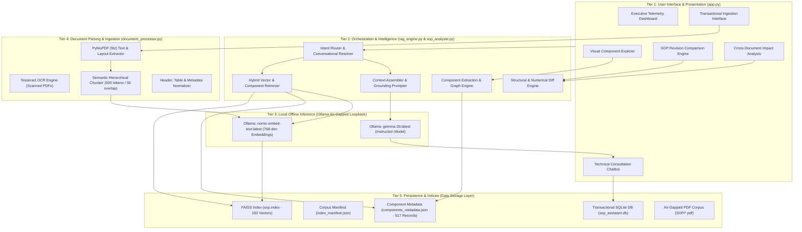
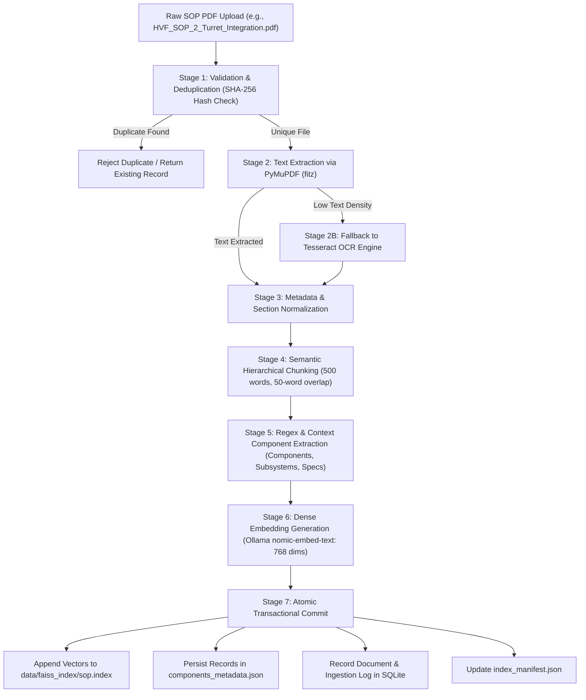
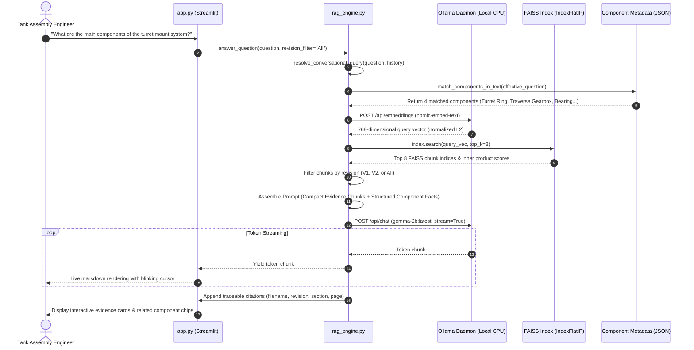
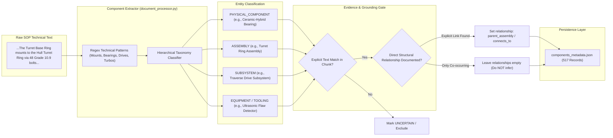
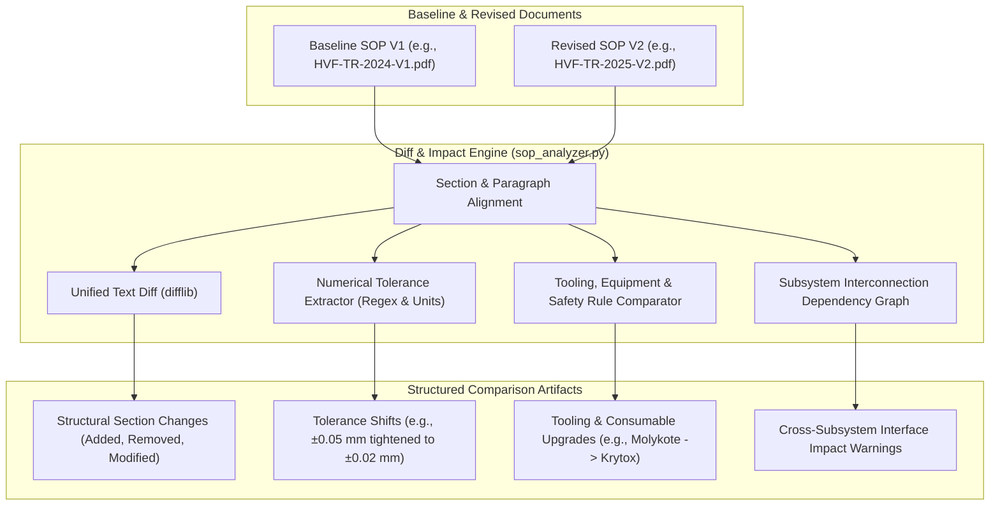
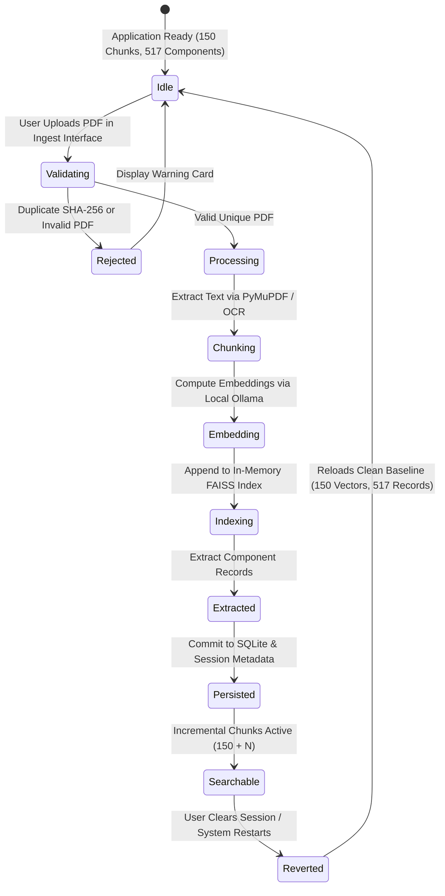

# Heavy Vehicles Factory (HVF) / Armoured Vehicles Nigam Limited (AVNL)
## Intelligent SOP Document Intelligence & Revision Impact Analysis Assistant
### System Architecture Specification

---

## 1. Executive Summary & Operational Context

The **SOP Document Intelligence & Revision Impact Analysis Assistant** is an offline-first, defense-grade technical intelligence platform engineered specifically for the Heavy Vehicles Factory (HVF), an operational production facility of Armoured Vehicles Nigam Limited (AVNL) located in Avadi, Chennai, Tamil Nadu, India.

HVF is the premier manufacturing complex for armored fighting vehicles (AFVs) in India, producing frontline main battle tanks (MBTs) such as the **T-90 Bhishma**, **T-72 Ajeya**, and the **Arjun MBT**, alongside heavy recovery and support vehicles. In defense manufacturing environments, Standard Operating Procedures (SOPs) govern mission-critical processes:
* Heavy armor plate welding and radiographic joint inspections
* Turret-hull ring integration and azimuth bearing runout checks
* V12 twin-turbo powerpack engine alignment and driveline backlash adjustments
* High-pressure hydraulic suspension and track-tensioning calibrations
* Main gun barrel trunnion mounting and digital fire-control zeroing

The application operates under a **strict air-gapped, CPU-only security envelope**. No engineering data, CAD references, tolerances, or procedure logs ever leave the local hardware perimeter. All intelligence is powered by local quantized open-weights models executed via Ollama, indexed using FAISS vector spaces, and tracked through a local SQLite transactional store.

---

## 2. High-Level System Architecture

The application adopts a modular, 5-tier architecture combining low-level document parsing, dense semantic vector retrieval, structured domain component graphs, cross-revision analytical diffing, and an interactive executive interface.



---

## 3. Five Core Modules & Responsibilities

The system maintains strict architectural modularity across five distinct Python modules:

| Module | Architectural Role | Core Responsibilities |
| :--- | :--- | :--- |
| [`app.py`](file:///d:/Parikshith/SOP_Assistant/app.py) | **Module 1: Streamlit Frontend** | Executive dashboard, telemetry, conversation tabs, live streaming LLM responses with typing indicators, interactive Component Explorer, revision comparison viewers, and 7-stage upload UI. |
| [`document_processor.py`](file:///d:/Parikshith/SOP_Assistant/document_processor.py) | **Module 2: Document Ingestion** | PDF text and table extraction via PyMuPDF, OCR fallback with Tesseract, deterministic semantic chunking (500 words, 50 word overlap), document hash deduplication, and component entity extraction. |
| [`rag_engine.py`](file:///d:/Parikshith/SOP_Assistant/rag_engine.py) | **Module 3: Hybrid Retrieval & Generation** | Hybrid retrieval fusing FAISS cosine dense vectors and structured component records, revision filtering (V1, V2, All), streaming Ollama inference, query resolution, and system health checks. |
| [`sop_analyzer.py`](file:///d:/Parikshith/SOP_Assistant/sop_analyzer.py) | **Module 4: Revision & Impact Analysis** | Section-by-section structural diffing between V1 and V2 SOPs, numerical tolerance shift extraction, tooling/safety change detection, and cross-subsystem interface impact propagation. |
| [`database.py`](file:///d:/Parikshith/SOP_Assistant/database.py) | **Module 5: Persistence & History** | SQLite database schema (`conversations`, `messages`, `uploaded_documents`, `indexing_history`), foreign keys, transactions, and conversation persistence. |

---

## 4. PDF Ingestion & Indexing Pipeline

Every technical SOP undergoes a deterministic, 7-stage transactional ingestion pipeline to guarantee reproducible indexing and avoid duplicate vector corruptions.



---

## 5. Query Processing & Hybrid RAG Retrieval Workflow

When an engineer asks a technical question, the system resolves conversational pronouns, extracts target component entities, and executes hybrid retrieval combining vector similarity with structured component facts.



---

## 6. Component Extraction & Relationship Validation Flow

The system extracts technical entities from SOP text into structured records, categorizing them into explicit types and strictly validating relationships only when documented in the text.



---

## 7. SOP Revision Comparison & Impact Analysis Flow

When comparing baseline V1 against revised V2 SOPs, the analysis engine detects section modifications, numerical tolerance tightening, tooling shifts, and cascading interface impacts.



---

## 8. Uploaded-Document Ingestion Lifecycle

The application supports transactional ingestion of newly uploaded user documents while preserving the baseline invariants (150 vectors and 517 baseline components).



---

## 9. Data Storage & Persistence Architecture

The persistence tier relies on three complementary formats chosen for robustness, auditability, and defense compliance:

```
SOP/
├── HVF_SOP_1_Hull_Welding.pdf          # Hull Welding V1
├── HVF_SOP_1_Hull_Welding_v2.pdf       # Hull Welding V2
├── HVF_SOP_2_Turret_Integration.pdf    # Turret Integration V1
├── HVF_SOP_2_Turret_Integration_v2.pdf # Turret Integration V2
├── HVF_SOP_3_Engine_Alignment.pdf      # Engine Alignment V1
├── HVF_SOP_3_Engine_Alignment_v2.pdf   # Engine Alignment V2
├── HVF_SOP_4_Torsion_Suspension.pdf    # Track & Suspension V1
├── HVF_SOP_4_Torsion_Suspension_v2.pdf # Track & Suspension V2
├── HVF_SOP_5_Gun_Calibration.pdf       # Gun Calibration V1
└── HVF_SOP_5_Gun_Calibration_v2.pdf    # Gun Calibration V2

data/
├── faiss_index/
│   ├── sop.index                   # FAISS IndexFlatIP (150 baseline 768-dim L2-normalized vectors)
│   ├── index_manifest.json         # Master manifest: 10 indexed PDFs, chunk ranges, hashes
│   └── components_metadata.json    # 517 structured entity records with exact citations
└── sop_assistant.db                # SQLite 3 transactional store (Conversations, Citations, History)
```

### SQLite Schema (`sop_assistant.db`)
1. **`conversations`**:
   - `conversation_id` (TEXT, PK): UUID4 identifier.
   - `title` (TEXT): Auto-generated or user-edited conversation title.
   - `created_at` (TIMESTAMP): Creation time in ISO-8601 format.
   - `updated_at` (TIMESTAMP): Last active timestamp.
2. **`messages`**:
   - `message_id` (INTEGER, PK, Auto-increment).
   - `conversation_id` (TEXT, FK -> `conversations.conversation_id`).
   - `role` (TEXT): `'user'` or `'assistant'`.
   - `content` (TEXT): Full response or prompt text.
   - `citations` (TEXT): JSON-serialized array of evidence citations.
   - `timestamp` (TIMESTAMP).
3. **`uploaded_documents`**:
   - `doc_id` (TEXT, PK): UUID4 identifier.
   - `filename` (TEXT): Original filename.
   - `file_hash` (TEXT, UNIQUE): SHA-256 checksum.
   - `file_size` (INTEGER): File size in bytes.
   - `total_pages` (INTEGER): Page count.
   - `total_chunks` (INTEGER): Vector count.
   - `ingested_at` (TIMESTAMP).
4. **`indexing_history`**:
   - `event_id` (INTEGER, PK, Auto-increment).
   - `event_type` (TEXT): `'INITIAL_INDEX'`, `'INCREMENTAL_UPLOAD'`, `'REINDEX'`.
   - `total_documents` (INTEGER).
   - `total_vectors` (INTEGER).
   - `status` (TEXT): `'SUCCESS'`, `'FAILED'`.
   - `timestamp` (TIMESTAMP).

---

## 10. Security, Air-Gap, and Operational Boundaries

The system enforces strict operational constraints to comply with defense data governance standards:

* **Strict Air-Gap Compliance**: Zero external socket connections. The socket layer binds exclusively to loopback `127.0.0.1:11434` for Ollama and `127.0.0.1:8501` for the local Streamlit dashboard. All external DNS, HTTP, HTTPS, and cloud API calls are blocked.
* **CPU Execution Compatibility**: All inference models (`gemma-2b` and `nomic-embed-text`) are quantized to run on standard multicore x86_64 CPUs without requiring dedicated CUDA/GPU hardware.
* **Deterministic Fact Grounding**: The LLM prompt engineering explicitly instructs the model to refuse answering when evidence is not contained in the retrieved context chunks. Component functions and relationships are never inferred from co-occurrence or naming conventions.

